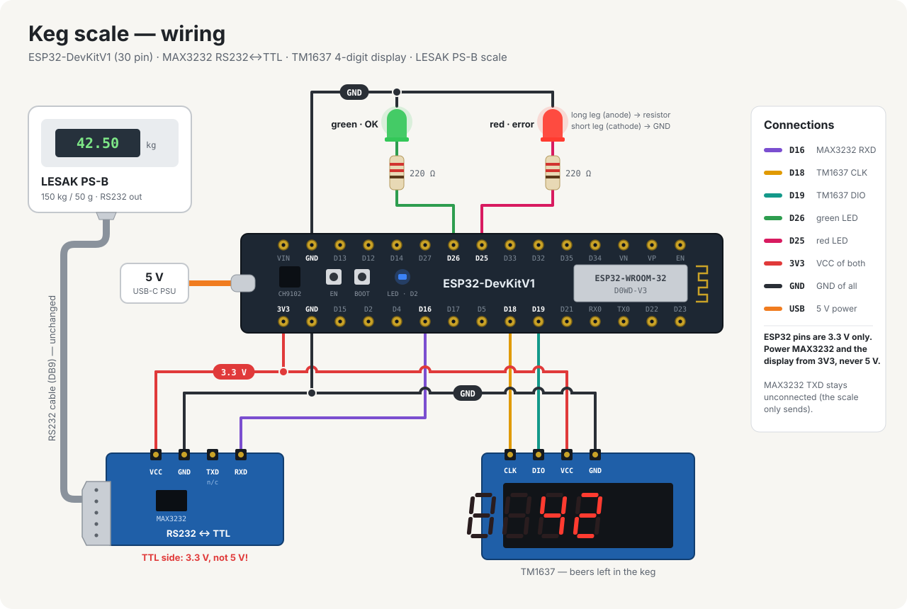

# Scale firmware

ESP32 firmware that reads the keg scale over RS232, sends the weight to the
backend and shows the number of beers left on a 4-digit display.

It replaces the original Arduino Uno WiFi Rev2 firmware. The message format
and the endpoint are unchanged, so the backend needs no changes.



## Hardware

- [ESP32-DevKitV1, 30 pin](https://dratek.cz/arduino-platforma/1581-esp-32s-esp32-esp8266-development-board-2.4ghz-dual-mode-wifi-bluetooth-antenna-module.html)
  (ESP32-D0WD-V3, CH9102 USB-UART, micro USB or USB-C)
- Scale LESAK PS-B, 150 kg / 50 g, RS232 output
- RS232 ↔ TTL module with MAX3232
- TM1637 4-digit 7-segment display
- Red and green LED, each with a 220 Ω resistor
- 5 V USB power supply

## Wiring

| ESP32 pin | Goes to | Note |
|---|---|---|
| `3V3` | MAX3232 `VCC`, TM1637 `VCC` | **3.3 V, not 5 V** — see below |
| `GND` (bottom row) | MAX3232 `GND`, TM1637 `GND` | |
| `D16` | MAX3232 TTL data output | UART2 RX |
| `D18` | TM1637 `CLK` | |
| `D19` | TM1637 `DIO` | |
| `D26` | 220 Ω → green LED anode | cathode to `GND` |
| `D25` | 220 Ω → red LED anode | cathode to `GND` |
| `GND` (top row) | both LED cathodes | |
| USB | 5 V power supply | |

The pins are defined in `src/config.h`; the diagram is generated from
`docs/wiring.py` (`make wiring`).

### 3.3 V only

ESP32 GPIOs are **not 5 V tolerant**. On the Arduino both modules ran from
5 V; here they must run from the `3V3` pin:

- **MAX3232** works from 3.0 to 5.5 V and its TTL output follows its supply.
  Powered from 5 V it would push 5 V straight into `D16`.
- **TM1637** modules have pull-ups on `CLK`/`DIO` to their `VCC`. At 3.3 V the
  display is a little dimmer, which is why the firmware runs it at full
  brightness.

### Which MAX3232 pin

TTL pin labels on these modules are inconsistent — some name them from the
module's point of view, some from the MCU's. Use the pin that went to Arduino
`D2` in the old setup (the old firmware notes that RX and TX were "not
switched", so on our module it is labelled `RXD`). If in doubt, measure: with
the scale on, the right pin idles at 3.3 V and flickers when the scale sends.

The module's `TXD` stays unconnected — the scale only talks, it never listens.
The RS232 (DB9) cable between the scale and the module stays as it is.

### Pins to avoid

If you need to move something: GPIO6–11 are wired to the flash, GPIO0, 2, 5,
12 and 15 are strapping pins (GPIO12 pulled high at boot breaks the flash
voltage), GPIO1/3 are the USB serial port and GPIO34–39 are input only.

## How it works

1. The scale streams frames like `:W 012.34kg…` at 9600 baud. The ESP32 reads
   them on hardware UART2 continuously.
2. `ScaleParser` (`src/scale_parser.h`) extracts the value. A frame must have
   the `k` unit and valid digits, and a value only counts once **two
   consecutive frames agree** — the scale repeats each frame several times and
   the last copy is often corrupted.
3. Every 5 s, if the weight changed since the last successful push, the device
   sends `push|<counter>|<rssi>|<grams>`.
4. If nothing was sent for 60 s, it sends `ping|<counter>|<rssi>|0` so the
   backend knows the scale is alive (and the pub open).
5. The backend answers every request with the number of beers left, which goes
   to the display.

Requests are `POST <backend URL>` with the token in the `Authorization`
header, the same as the pinger.

## Configuration

Nothing is compiled in — Wi-Fi, backend URL and auth token are set from a
captive portal and stored in NVS (`Preferences`, namespace `kegscale`):

- up to 20 Wi-Fi networks, tried via `WiFiMulti`
- `url` — backend endpoint, default `https://pub.kotrzina.cz/api/scale/push`
- `token` — value of the `Authorization` header

Both `http://` and `https://` URLs work, with an optional port. HTTPS
encrypts the traffic, including the token, but uses `setInsecure()`: the
server certificate is not verified, same as in the pinger.

### Opening the portal

The display shows `conF` while the portal is running.

1. **Double reset within 3 seconds**: press `EN`, and press it again while the
   blue LED is still blinking fast (red and green are lit during that window).
   Cutting and restoring the power twice works the same way.
2. Connect to the `KegScale-Setup` access point.
3. Set **WiFi** and, under **Setup**, `Backend URL` and `Auth token`.
4. Save. The device reboots and starts measuring.

The portal also opens on its own when there are no stored networks, no URL or
no token, or when Wi-Fi does not connect within 15 s. It times out after
5 minutes and reboots. Stored networks are kept; re-entering a known SSID
updates its password.

### Optional pre-seeding

Copy `src/secrets_example.h` to `src/secrets.h` (gitignored) to bake in a
default URL, token and Wi-Fi list. Values saved from the portal always win.

## Display and LEDs

| What | Meaning |
|---|---|
| Display `----` | booting, no answer from the backend yet |
| Display `conF` | captive portal is running |
| Display number | beers left, from the last successful request |
| Green LED | last request succeeded |
| Red LED | last request failed, or Wi-Fi is down |
| Red + green for 3 s after boot | double-reset window |
| Blue LED solid | connected, backend answering |
| Blue LED slow blink (1 s) | Wi-Fi fine, backend not answering — check URL/token |
| Blue LED fast blink (200 ms) | double-reset window, connecting, or Wi-Fi lost |
| Blue LED off | captive portal |

## Watchdog

`loop()` is subscribed to the ESP-IDF task watchdog, which is fed only after a
request the server answered with 200. With no successful request for
5 minutes the device reboots and goes through the whole connect flow again.
That covers a wedged Wi-Fi stack, an unreachable backend and a hung library
call alike.

## Build

```bash
make install   # ESP32 core + board manager URL (once)
make deps      # WiFiManager, TM1637
make compile
make flash
make test      # parser unit tests on the host, needs only g++
```

Serial logging is compiled out by default. For a chatty build:

```bash
make flash-debug
make monitor   # 115200 baud
```

The CH9102 USB converter needs no driver on current Linux and macOS; the port
shows up as `/dev/ttyACM*` / `/dev/ttyUSB*` or `/dev/cu.wchusbserial*`. If
uploading hangs at `Connecting...`, hold `BOOT` until it starts.
